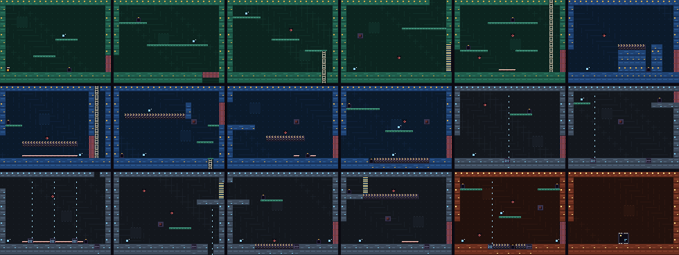
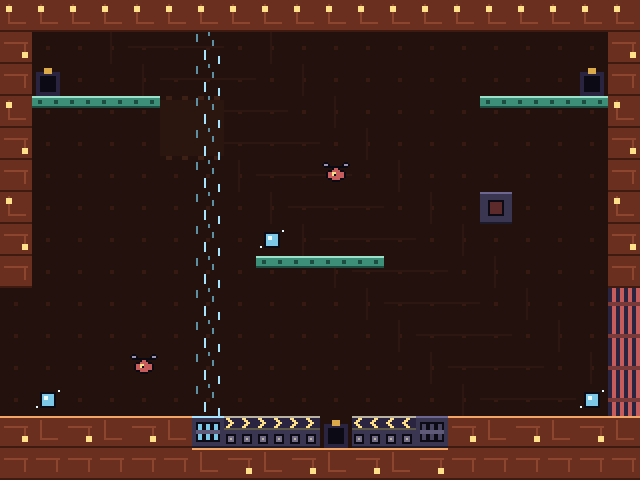

# Circuit Courier

Guide a tiny maintenance bot through a circuit board. Carry and throw data bits into sockets to open doors, solve puzzles with belts and fans, and reach the CPU.

For the Zeal 8-bit computer with the Video Board, running Zeal 8-bit OS.

 

## Controls

Menu prompts default to a connected SNES pad and follow the last device used
in the menu. The selected keyboard/pad display stays fixed during the game.

| Action | Keyboard | SNES |
|---|---|---|
| Move | arrows | D-pad |
| Jump (double jump when empty-handed) | Z / Space | B |
| Throw bit (forward) | X | A |
| Throw bit straight up | Up + X | Up + A |
| Set bit down | Down + X | Down + A |
| Climb ladder | Up / Down | Up / Down |
| Reset room | Enter | Start |
| Quit | Right Shift / ' | Select |

Bits are picked up by touching them. A bit that lands in a socket (carried or thrown) plugs in.
Carrying a bit costs the double jump, which is the core puzzle: throw it up to a ledge first, then
double jump after it. A flying bit also stuns drones for 3 seconds and flips switches.

## How to play

- Touch a bit to pick it up; carry or throw it into a socket to plug it in.
- You can double-jump while empty-handed. Throw a bit to a ledge before jumping after it.
- Fill sockets to open doors. Flying bits also stun drones and toggle switches.

## Build

Install the Zeal Development Environment (ZDE) and its SDK dependencies, then run
these commands from this repository:

```sh
zde deps install zgdk
zde deps install zar
zde cmake
```

The build produces `bin/courier.bin` and `bin/courier.zar`.
Use a current ZGDK installation.

## Run

For Zeal-NativeEmulator, mount the output folder as HostFS:

```sh
zeal-native -r /path/to/os_with_romdisk.img -H bin
```

At the ZOS prompt:

```text
cd H:/
exec courier.bin
```

On hardware, copy the `.bin` and `.zar` together and run the game from that folder.

Build variants, asset editing and optional development tools are documented in
[the development guide](docs/development.md).

## License

Copyright 2026 David Higgins. Game code and original assets are licensed under
[Apache License 2.0](LICENSE). External SDKs and tools retain their own licenses.
